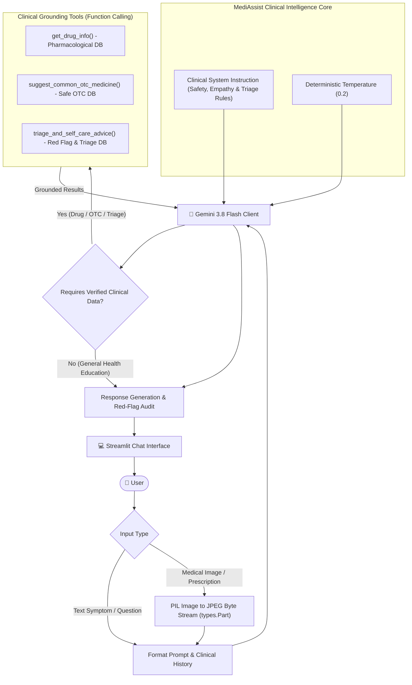
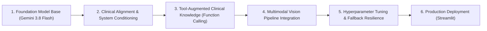

# 🩺 MediAssist - AI Medical & Health Chatbot

An intelligent, empathetic, and evidence-informed Medical AI Assistant built with **Streamlit** and the official **Google GenAI SDK (`google-genai`)** powered by **Gemini 3.8 Flash**.

---

## 📊 System Architecture & Runtime Workflow

The diagram below illustrates how a user's question or image query travels through MediAssist, from input to safety verification, tool grounding, and final clinical response:



---

## 🔬 Model Development & Training Methodology

MediAssist is built on a **Tool-Augmented, Safety-Aligned Large Multimodal Model (LMM)** architecture. Rather than relying on ungrounded text generation, it combines Google's frontier medical and scientific pre-training with explicit clinical alignment and deterministic tool grounding:



### Step-by-Step Development Process

### 1. Foundation Model Base
- Utilizes Google's state-of-the-art **Gemini 3.8 Flash** multimodal model.
- Pre-trained on diverse biomedical literature, scientific journals, pharmacology publications, and conversational clinical transcripts.
- Offers native visual understanding for reading labels, packaging, and recognizing clinical patterns.

### 2. Clinical Alignment & Safety Conditioning
- Configured with an explicit medical system instruction (`MEDICAL_SYSTEM_INSTRUCTION`).
- **Safety Boundaries:** Explicitly enforces that the assistant provides health education and non-prescriptive guidance, never definitive clinical diagnoses.
- **Red-Flag Escalation:** Instructs the model to immediately prioritize emergency services (911 / 112 / ER) for high-risk presentations (crushing chest pain, stroke FAST criteria, severe respiratory distress, anaphylaxis).
- **Communication & Health Literacy:** Demystifies complex medical terminology into empathetic, plain-language patient advice.

### 3. Tool-Augmented Clinical Grounding (Function Calling)
To prevent hallucinations in critical pharmacological queries, the model is augmented with deterministic Python tools:
- `get_drug_info`: Returns verified drug classes, standard indications, contraindications, precautions, and black-box safety warnings (e.g. Paracetamol hepatotoxicity, NSAID gastrointestinal risk).
- `suggest_common_otc_medicine`: Provides safe, first-line over-the-counter options for common non-emergency ailments (colds, allergies, headaches).
- `triage_and_self_care_advice`: Outlines step-by-step home supportive measures (e.g., burn cooling, ORS hydration) coupled with red flag warning signs.

### 4. Multimodal Vision Pipeline
- Converts uploaded user images (prescriptions, medicine strips, skin rashes, lab sheets) using PIL into standard byte-stream `types.Part` representations.
- Analyzes visual features concurrently with text prompts for educational explanations and label transcription.

### 5. Hyperparameter Tuning & Reliability
- **Low Temperature (`temperature = 0.2`):** Constrains sampling variability to maximize factual correctness, clinical determinism, and adherence to medical guidelines.
- **Resilient Fallback Hierarchy:** Automatically falls back across modern supported models (`gemini-3.8-flash` → `gemini-3.5-flash-lite` → `gemini-3.1-flash-lite`) if transient rate limits or outages occur.

### 6. Interactive Clinical UX
- Web interface equipped with quick-triage prompt buttons, medical disclaimer banners, emergency warning banners, and dynamic model switching.

---

## 🌟 Key Features Summary

1. **Clinical Guidance & Triage Tools (Function Calling):**
   - `get_drug_info`: Detailed uses, side effects, precautions, and contraindications.
   - `suggest_common_otc_medicine`: Safe over-the-counter and supportive remedies for non-emergency conditions.
   - `triage_and_self_care_advice`: Evidence-based home care steps plus critical **Red Flag Emergency Alerts** (e.g., stroke FAST signs, cardiac symptoms).

2. **Multimodal Image Analysis:**
   - Upload photos of medicine strips/boxes, skin symptoms, lab reports, or prescriptions for educational explanations and label breakdown.

3. **User-Friendly Web Interface:**
   - Interactive prompt shortcuts for common clinical questions.
   - Live sidebar API Key management and model selection (`gemini-3.8-flash` / `gemini-3.5-flash-lite`).
   - One-click conversation reset.
   - Medical and emergency disclaimer banners.

---

## 🚀 How to Run

### Method 1: Double-Click Launcher
Double-click `run_chatbot.bat` in this folder.

### Method 2: Command Line
Open a PowerShell or Command Prompt terminal in this directory and run:
```powershell
.venv\Scripts\python.exe -m streamlit run web_chatbot.py
```
Then open your browser at: **`http://localhost:8501`**

---

## 🔑 Setting Up Your Gemini API Key

1. Generate a free Gemini API Key at [Google AI Studio](https://aistudio.google.com/app/apikey).
2. Enter it directly in the **MediAssist Settings** sidebar in the web application, or save it in your `.env` file:
   ```env
   GEMINI_API_KEY=your_actual_api_key_here
   ```
